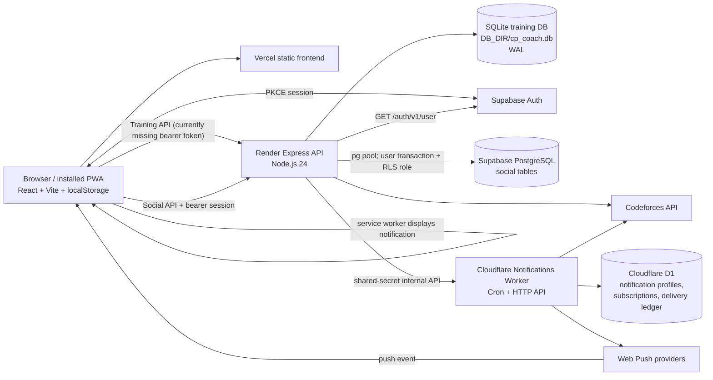

# CP Coach — Project Context for Claude

> **Generated:** 2026-11-04  
> **Repository:** `Obada111/cp-coach`  
> **Branch:** `main`  
> **HEAD at inspection:** `21da4ccc19f3734aa887a656740f143c39e51e3e` (`Use stable lazy feature component types`)  
> **Working tree:** already contained extensive modified and untracked files before this document was created. This handoff describes the current working tree, not just HEAD. No existing changes were reverted.  
> **Validation scope:** this documentation-only task did not run builds or tests and did not verify any live provider deployment. Historical test results in other documents are not current results.

This is a repository-grounded handoff, not a claim that CP Coach is production-ready. In particular, the current tree has durable-disk configuration and backend Supabase token checks, but the training frontend does not send a Supabase bearer token and there is no top-level training sign-in gate. These blockers are described in [Current status and release blockers](#12-current-status-and-release-blockers).

## 1. Project overview

CP Coach is a Codeforces-focused training application. It aims to turn public Codeforces activity and a learner's own practice feedback into a repeatable learning loop:

1. Connect a Codeforces handle.
2. Synchronize profile, submissions, ratings, contests, and problem metadata.
3. Generate a small daily set that balances weakness practice, reinforcement, and stretch work.
4. Record attempts, feedback, reflections, verified accepts, and review outcomes.
5. Use that evidence to guide later recommendations and spaced review.
6. Optionally use contests, social features, and Web Push reminders to support the routine.

This is more than a statistics page: it has a rule-based recommendation pipeline, a learner model, review scheduling, and feedback-driven state. It is not an AI/LLM coach, and some material (notably the concept journal and virtual-contest sessions) remains browser-local rather than account-synchronized.

### User-facing scope

- View a Codeforces profile and rating history.
- Refresh submissions and contest data.
- Work through daily recommendations and provide structured feedback.
- Inspect weak/unexplored topics, review due problems, and use progressive tutorial hints.
- Record solve-session reflections and verified solve status.
- Set weekly goals and read weekly coaching reports.
- Record contest participation, review contest problems, and send problems to review.
- Keep personal knowledge notes and virtual-contest reports in browser storage.
- Optionally connect social features (friends, presence, Codeforces blogs) and device notifications.

### Intended audience and limitations

The current product is aimed at individual competitive programmers, not yet at coach/student groups, classes, or shared team training. Friends/social functionality is present, but that is not the same as a coach permission model. The project contains no verified group, student, assignment, or instructor workflow in the inspected training routes and SQLite schema.

## 2. Technology stack

| Area | Technologies used in the working tree | Purpose |
|---|---|---|
| Frontend | React 18, TypeScript, Vite | SPA and PWA interface |
| Styling/UI | Tailwind CSS, Lucide icons, `clsx`, `tailwind-merge` | Styling, icons, and class composition |
| Visualization | Recharts | Rating and progress charts |
| Frontend auth | `@supabase/supabase-js` | Supabase PKCE session for the social surface; intended to be reused by training API |
| Backend | Node.js 24, TypeScript, Express | HTTP API, Codeforces sync, recommendations, reviews, sessions, and reminders |
| Local/training DB | Node built-in `node:sqlite` (`DatabaseSync`) | SQLite training/profile state and public-data caches |
| Social DB | `pg` | Backend PostgreSQL pool for Supabase social tables |
| Auth verification | Supabase Auth `/auth/v1/user` endpoint | Validates bearer access tokens server-side |
| External data | Codeforces public API | Profiles, ratings, submissions, problemset, and contests |
| Notifications | Web Push / VAPID, Cloudflare Workers, Cron Triggers, D1 | Notification APIs, persistent subscriptions/settings/delivery state, scheduled delivery |
| PWA | Web manifest, service worker, static asset cache | Installable app shell and push event handling |
| Hosting config | Vercel static build, Render web service | Frontend and API deployment configuration |
| Testing/build | Vitest, TypeScript compiler, Vite, Wrangler/Workerd test plugin | Backend/worker tests, builds, and type checks |
| Supabase local config | Supabase CLI configuration and SQL migration | Local Auth/PostgreSQL development if Docker is available |

Dependency manifests are evidence of actual use only where the application imports or invokes a package. Root `supabase` CLI usage and worker tooling are not required to run the frontend/backend training loop.

## 3. Application architecture

### Component diagram



The diagram distinguishes intended/current code paths from working production behavior. The Render Blueprint in the working tree declares a paid Starter service and a 1 GB persistent disk. That configuration has not been applied or verified against a live Render service. The Cloudflare D1 `database_id` is still a placeholder in the checked-in Wrangler config. No production service state was inspected.

### Data flows

#### Account/session and training profile

1. `frontend/src/socialAuthClient.ts` constructs a Supabase JS client with PKCE, persistent sessions, auto-refresh, and URL-session detection.
2. `frontend/src/components/SocialHub.tsx` restores a session and sends it to social API calls through `frontend/src/socialApi.ts`.
3. `backend/src/socialAuth.ts` and `backend/src/authMiddleware.ts` verify access tokens with Supabase Auth in the backend and derive the account UUID from the verified `sub`.
4. Training profile endpoints use the server-derived user ID as `owner_id`; profile and resource resolution checks that owner before handing the request to the core API router.
5. **Current integration gap:** the dashboard is not wrapped in an auth gate and the training request transport in `frontend/src/api.ts` sends client/handle headers but no Authorization bearer. Thus the protected training API rejects the normal frontend request when public mode is configured for auth.

#### Codeforces synchronization and recommendations

1. The user submits a handle through the profile endpoint; the backend validates it against Codeforces.
2. `codeforcesService.ts` and `codeforcesCacheService.ts` request and cache public profile, rating, submissions, contests, and problemset data.
3. `analysisService.ts` and `recommendationService.ts` derive learner state and daily assignments from cached submissions, topic performance, recent assignments, and user feedback.
4. Assignments and learner history are stored per SQLite profile. Reference Codeforces data is also stored in shared cache tables keyed by handle/problem/contest.
5. Daily feedback, session events, contest reviews, and verified accepts feed `problem_learning_events` / learner state and can influence subsequent planning.

#### Review and contest flow

Review events are handled by `reviewService.ts`; API routes enqueue or update a user's review item, and the per-profile queue stores its due date, interval, repetition count, state, and notes. Contest sync and participation state flow through `contestService.ts`, contest routes, `user_contests`, `contest_problem_reviews`, `contest_problems_meta`, and `codeforces_contests`.

#### Push notifications

1. The browser requests notification permission only through an explicit UI action and creates a Push API subscription.
2. The browser sends the subscription and preferences to the training API. The backend checks the authenticated profile/owner and forwards notification state to Cloudflare when the repository is configured.
3. The backend synchronizes a limited current-day recommendation snapshot to the worker.
4. A Cloudflare Cron Trigger calls the worker scheduler; D1 tracks profile settings, subscriptions, contests, claims, delivery state, and worker runs.
5. The worker verifies whether a daily reminder is still appropriate, signs/encrypts a Web Push payload, sends it to the provider endpoint, deduplicates delivery, and removes expired endpoints.
6. The service worker displays the push event. API responses are excluded from service-worker caching.

#### Social flow

The social router requires Supabase Auth. Social data is read/written in PostgreSQL transactions that set the current user's JWT claims and role so policies in `supabase/migrations/202611020001_phase1_social.sql` can scope access. Codeforces account ownership uses a short-lived first-name challenge; optional API credentials are encrypted server-side before storage. A background sync service refreshes eligible social data.

## 4. Database and data model

### SQLite training database

`backend/src/db.ts` opens `DB_DIR/cp_coach.db`, enables WAL and a busy timeout, and creates/upgrades most tables at process startup. Local default is `backend/data`; Render's current Blueprint sets `/var/data/cp_coach`. Production startup rejects a path recognized as ephemeral `/tmp`. There is no general versioned training migration runner; the code uses `CREATE TABLE IF NOT EXISTS`, `ALTER TABLE`, and specific rebuild/backfill functions.

| Table(s) | Responsibility and ownership |
|---|---|
| `profiles` | Training profiles. `owner_id` is null for local/private legacy profiles and is set to the verified account UUID for public accounts in the auth-enabled route path. |
| `settings` | Global key/value settings, including local active-profile selection. Not designed as an account-scoped preference store. |
| `daily_sets`, `daily_problems` | Per-profile dated recommendations and assignment state/feedback; daily problems reference a set, profile, and shared problem. |
| `problems`, `curriculum_problems` | Shared Codeforces problem catalog and curated curriculum content. |
| `learner_profile_state` | Per-profile serialized learner-model state. |
| `problem_learning_events` | Per-profile unified learning journal/event records and source keys. |
| `review_queue` | Per-profile review schedule and review notes. |
| `solve_sessions` | Per-profile active/completed solving sessions, hints, editorial use, durations, outcome, and reflections. |
| `weekly_goals` | Per-profile weekly targets, focus topics, and notes. |
| `user_contests`, `contest_problem_reviews` | Per-profile contest participation and problem-level review/upsolve state. |
| `contest_problems_meta`, `codeforces_contests` | Shared Codeforces contest/problem reference cache. |
| `submissions`, `rating_history`, `profile_cache` | Cached external Codeforces activity, rating, and profile metadata keyed primarily by handle or external IDs. |
| `sync_meta`, `sync_leases` | Shared refresh metadata and process-level sync coordination; lease owner is not a user identity. |
| `notification_settings`, `push_subscriptions`, `notification_deliveries` | Local-mode reminder preferences, browser endpoints, and delivery retry/dedupe state. Public deployments can instead use Cloudflare repository paths. |

Most learning tables have `profile_id` foreign keys and profile-specific indexes. Server access control is implemented in Express profile resolution and ownership guards; SQLite itself does not provide row-level security. Accordingly, every public route must preserve the authenticated-owner scoping boundary.

### Supabase PostgreSQL

The social migration is the only application PostgreSQL migration found. It creates social profiles, Codeforces link challenges and encrypted credentials, friend requests/friendships/presence/preferences, blog watchlist/cache/state, sync state, and social notifications. It enables RLS and grants narrow policies to the `authenticated` role. It does **not** create or migrate the training tables. `DATABASE_URL` is used by `socialDatabase.ts`; its live connection target and current capacity were not checked.

### Cloudflare D1

`cloudflare/notifications-worker/migrations/0001_notification_schema.sql` creates notification profiles, subscriptions, contests, delivery ledger, and worker state/runs. `0002_contest_reminder_offsets.sql` adds the offsets setting. These are additive worker migrations, separate from SQLite and Supabase. The worker database ID remains a placeholder in `wrangler.jsonc`; remote D1 setup/migration status is unknown.

### SQLite vs PostgreSQL decision

For the current implementation-compatible durable training store, **SQLite on a Render Persistent Disk is the lower-risk choice**. The training code is built around synchronous `DatabaseSync` and SQLite SQL directly across the database module and services. Retaining SQLite avoids a large, high-risk rewrite and preserves the existing schema/data format. At the small single-service scale targeted by this code, WAL and indexed profile-scoped queries are a reasonable starting point.

| Consideration | Option A — SQLite + Render Persistent Disk | Option B — training data in existing Supabase PostgreSQL |
|---|---|---|
| Compatibility | Direct fit for `DatabaseSync`, existing schema, `?` placeholders, and synchronous service calls. | `pg` exists only for social paths. Training services would need async repository changes, `$n` placeholders, Postgres-compatible SQL, transaction changes, and migration/seed work. |
| Code changes | Configure `DB_DIR` under the mounted disk, enforce auth/ownership, verify backup/restore, and establish off-host backup automation. Current `render.yaml` already declares `/var/data/cp_coach`. | Rebuild training repositories/services, add full versioned PostgreSQL schema and data importer, handle transaction/pooler semantics, and add RLS/ownership policy tests. Not implemented. |
| Performance/concurrency | Local, low-latency reads; WAL allows readers alongside a writer, but SQLite has one writer at a time and the disk-backed Render service is effectively single-instance. Sync SQLite calls can block the Node event loop during long operations. | Multiple concurrent readers/writers and easier horizontal service scaling; network round trips and connection-pool/RLS overhead must be managed. |
| Migration complexity | Preserve the file and move/copy it only after a verified consistent backup. Existing startup migrations still need review and rehearsal. | High: map all profile IDs and records, reconcile SQLite/social/D1/browser copies, preserve constraints and timestamps, and validate counts/content. No automatic owner mapping is safe. |
| Backup/restore | Use SQLite online backup/`VACUUM INTO`, encrypted off-host retention, integrity/FK checks, and periodic restore rehearsal. A persistent disk is not a backup. | Supabase plan-dependent managed backup/PITR plus independent exports and restore drills. Existing plan and retention are unknown. |
| Hosting limits | Persistent disks require a paid Render service, are tied to one instance, constrain scaling, and disk-backed deploys can incur downtime. No multi-region HA. | Depends on the existing Supabase project's plan, compute, region, connection limits, storage, and backup tier; the project cannot be assumed durable just because `DATABASE_URL` is present. |
| Expected cost (estimate, not account quote) | Current Blueprint is Render Starter + 1 GB disk. At the public list prices checked for this handoff, budget about **$7/month service + $0.25/GB-month disk = about $7.25/month**, before tax/egress/overages. Free Render services cannot attach a persistent disk. | If the existing Postgres project has sufficient paid capacity, incremental database cost may be $0; otherwise Supabase Pro starts around **$25/month**, with project compute/usage subject to its billing model. Keep the Render API cost if it remains hosted there. Existing plan/invoice is unknown. |

**Important distinction:** PostgreSQL with correctly enforced RLS is the stronger long-term isolation boundary, but changing a database technology does not make the present code safe by itself. A rushed SQLite-to-PostgreSQL rewrite without full data migration and per-user RLS tests would be less safe than preserving the current training DB on durable storage. Revisit Option B when the async repository migration and staging import are fully tested. No paid resource has been purchased or created by this documentation task.

Pricing/hosting references: [Render persistent disks](https://render.com/docs/disks), [Render service types](https://render.com/docs/service-types), [Render pricing](https://render.com/pricing), [Supabase pricing](https://supabase.com/pricing). Provider billing and live resource status are not accessible from this repository; re-check before provisioning.

## 5. Feature inventory and evidence

Status labels describe repository evidence, not a live-service guarantee:

- **Implemented; locally testable:** source and tests exist, but this pass did not rerun tests.
- **Implemented; production unverified:** source exists but no live provider/device verification is evidenced.
- **Partial / blocked:** some code exists but a required end-to-end surface is absent or mismatched.
- **Not implemented:** no supporting training workflow was found.

| Feature | What users can do / implementation | Evidence and storage | Status |
|---|---|---|---|
| Codeforces profile integration | Connect one or more handles, validate against Codeforces, refresh data. | `Onboarding.tsx`, `App.tsx`, `api.ts`; backend `codeforcesApi.ts`, `codeforcesService.ts`, `codeforcesCacheService.ts`; `profiles`, `profile_cache`, `submissions`. | Implemented; external API uptime and production config unverified. |
| Dashboard/statistics | See profile summary, daily set, topics, progress, and sync status. | `DashboardHome.tsx`, `App.tsx`, `ProfileOverview.tsx`, backend dashboard routes/services. | Implemented; frontend training requests currently lack bearer auth in public mode. |
| Rating history | View rating progression. | `RatingChart.tsx`, backend rating-history queries; `rating_history`. | Implemented; chart lazy-loaded; production unverified. |
| Daily training | Three labeled recommendations with progress/open/feedback state. | `DailyTrainingSection.tsx`, `DailyProblemCard.tsx`, `ProblemCard.tsx`, `recommendationService.ts`; `daily_sets`, `daily_problems`. | Implemented. |
| Recommendations/weakness analysis | Select practice from topic evidence and rating; represent low-evidence topics as unexplored. | `analysisService.ts`, `recommendationService.ts`, curriculum; `learner_profile_state`, `problem_learning_events`, submissions. | Implemented with rules; thresholds and recommendation behavior have unit tests, not production outcome studies. |
| Feedback and learning journal | Record solve status, perceived difficulty, struggle, notes, and review events. | `ProblemCard.tsx`, `KnowledgeJournal.tsx`, `ProblemJournalList.tsx`; backend journal/feedback services; `problem_learning_events`, `daily_problems`. | Implemented; some concept notes are browser-local. |
| Progressive hints/tutorials | Reveal tutorial guidance and problem explanations. | `TutorialModal.tsx`, `tutorialService.ts`, tutorial routes and curriculum. | Implemented; content coverage varies by problem. |
| Review queue | Enqueue/review problems and manage due state. | `ReviewQueueCard.tsx`, `reviewService.ts`, review routes; `review_queue`. | Implemented; backend review tests exist. |
| Weekly goals/report | Set weekly solve/contest/upsolve targets and review performance. | `WeeklyCoachReport.tsx`, goal/report routes and services; `weekly_goals`, learning events, contests. | Implemented; report tests exist. |
| Solve sessions | Track time, hints/editorial usage, outcome, and reflection. | `SolveSessionModal.tsx`, `solveSessionService.ts`; `solve_sessions`, learning events. | Implemented; protected-route auth integration incomplete on frontend. |
| Contests | Sync upcoming/official contests, record participation, review/upsolve problems. | `ContestsView.tsx`, contest APIs/services; `user_contests`, `contest_problem_reviews`, shared contest tables. | Implemented; external sync unverified. |
| Knowledge journal | Store searchable personal concept notes. | `KnowledgeJournal.tsx`, `knowledgeJournal.ts`; browser `localStorage`, not SQLite/Postgres. | Implemented but browser/device-local. |
| Virtual contests | Run/report a past contest locally. | `VirtualContestSession.tsx`, `virtualContest.ts`; browser `localStorage`. | Implemented but browser/device-local. |
| Social/friends/blogs | Email-link sign-in, verified Codeforces linking, friends, presence, blog watchlists and reading state. | `SocialHub.tsx`, social client; `socialRoutes.ts`, `socialDatabase.ts`; Supabase migration. | Implemented in code; live DB/RLS and production behavior unverified. |
| Push notifications | Subscribe a device, set preferences, scheduled daily/contest reminders. | `NotificationsSettings.tsx`, `notifications.ts`; backend notification repository; Worker/D1. | Implemented in code; Cloudflare database ID is placeholder and real push has not been verified. |
| PWA/offline shell | Install app and load cached static shell/assets; offline dashboard snapshot is browser storage. | `manifest.webmanifest`, `public/sw.js`, `api.ts`. API responses are not service-worker-cached. | Implemented; real Android/iOS testing unverified. |
| Signup/sign-in for training | A user should register and reach a private training dashboard. | Supabase client/auth middleware exist separately, but no top-level auth gate and no training bearer header in `api.ts`. | **Partial / blocked.** |
| Coach/student or group training | Invite students, assign training, share reports, manage permissions. | No such route/schema workflow identified. | Not implemented. |

### What is genuinely distinctive today

- **Personalized practice rather than only charts:** recommendations draw on submissions and learner feedback and are divided into weakness, reinforcement, and challenge roles. This is a real implementation path, not merely a product description.
- **Closed learning loop:** attempts, verified accepts, subjective feedback, reflections, review queue, and future planning are connected through profile-scoped state and learning events.
- **Evidence-aware analysis:** the code distinguishes weak topics from topics with insufficient attempts; verified Codeforces accepts are separated from user self-reports.
- **Contest follow-up:** contests can be recorded and reviewed problem by problem, with upsolves entering the learning/review flow.
- **Mobile/PWA foundation:** static offline shell and push are implemented, but actual device/provider delivery is not evidenced.

These are implemented software capabilities, not independently measured learning gains, retention improvements, accuracy benchmarks, or production reliability claims.

## 6. Authentication, authorization, privacy, and legacy data

### Current mechanisms

- Public training routes are under `/api/public`.
- `publicRoutes.ts` leaves a small set of non-personal endpoints accessible (health, handle validation, notification configuration); later training routes require authentication.
- `authMiddleware.ts` reads a bearer token, validates it with Supabase Auth `/auth/v1/user`, and derives the UUID from the verified user response/claims.
- `publicRoutes.ts` resolves selected profiles only when their `owner_id` matches the authenticated user ID. Daily assignments, review entries, and solve sessions have additional ownership checks.
- Social routes are separately guarded by `requireSupabaseUser` and use user-scoped PostgreSQL transactions/RLS.
- `X-Coach-Client-Id` still exists in the frontend transport and some test fixtures. In production it is not a verified identity; the server's intended owner is the Supabase UUID. There is a test-only legacy fallback, which is not production authentication.
- Local/private `/api` behavior uses `auth.ts` API-token middleware; public mode mounts the legacy API under `/api/admin` only when a configured admin token is provided.

### Critical gaps

1. **Training frontend and backend disagree.** `apiFetch` decorates public training calls with the generated client ID and selected handle but not `Authorization: Bearer <Supabase access token>`. A normal training dashboard request therefore receives 401 after the public router's auth middleware. No global signup/sign-in/loading/session-restoration screen protects the dashboard.
2. **Account-aware local cache is absent.** Context snapshots, offline dashboard snapshots, knowledge notes, handle lists, and virtual contest data are keyed by handle/browser storage keys, not by verified Supabase account. Account switching in a shared browser can surface another account's cached data unless those stores are partitioned or cleared.
3. **Legacy claim path is incomplete.** `/profiles/claim-legacy` can require a verified linked Codeforces handle or a configured migration secret. However, the current `claimLegacyProfile` helper only claims profiles whose `owner_id` is null; legacy public profiles created with client IDs have a non-null owner. Thus the endpoint cannot presently migrate those client-owned records as a complete account-transition path. The UI also does not present a full migration/confirmation flow.
4. **No complete two-user training security matrix is present.** Existing public API tests exercise client-ID tenant separation and social auth tests exercise Supabase token verification, but the inspected suite does not establish all requested A-vs-B tests for training records, recommendations, weekly goals, notification preferences/subscriptions, changed client IDs, expired sessions, and cache switching.
5. **SQLite access relies on application checks.** There is no SQLite RLS. A future route, service, or import bypass that forgets profile ownership could cross tenant boundaries.
6. **Social PostgreSQL is not training PostgreSQL.** Existing PostgreSQL RLS only covers social tables. It does not protect SQLite training records.

### Existing data handling

- Do not infer the rightful account from a Codeforces handle, a client ID, or an arbitrary Supabase account.
- Existing public profile `owner_id` values came from client identifiers; they do not prove an authenticated owner.
- Browser backups and browser-only notes/virtual contests may not exist on the server. Keep each device's export as a separate source and require an explicit, reviewed import.
- A safe future process is: verified Codeforces ownership, display candidate legacy records and row counts, explicit user selection/confirmation, pre-migration SQLite snapshot, transactional ownership update with a recorded crosswalk, and read-back integrity/isolation checks. The current route/helper is not yet a complete implementation of that process.
- No production records were re-associated or migrated by this documentation task.

## 7. API inventory

All personalized training endpoints are intended to be scoped by the verified owner and selected profile. The profile ID is a selector, never proof of ownership.

### Public-mode training API

| Method / path | Purpose | Auth |
|---|---|---|
| `GET /api/public/health` | Backend/database readiness and instance identity | Public |
| `GET /api/public/handle/validate` | Validate a Codeforces handle | Public; rate-limited |
| `GET /api/public/notifications/config` | Report notification readiness/configuration | Public; does not expose a user's settings |
| `GET /api/public/network-info` | Deliberately unavailable/404 | Public |
| `GET /api/public/profiles` | List current user's profiles | Supabase bearer required |
| `POST /api/public/profiles` | Validate/create a profile | Supabase bearer required |
| `POST /api/public/profiles/:id/select` | Validate profile selection | Supabase bearer required |
| `DELETE /api/public/profiles/:id` | Delete the authenticated user's profile and scoped data | Supabase bearer required |
| `POST /api/public/profiles/claim-legacy` | Explicit legacy-claim attempt | Supabase bearer + verification/secret; implementation gap described above |
| `GET/POST /api/public/context` | Export/import profile context | Supabase bearer required |
| `GET /api/public/dashboard`, `/daily`, `/history`, `/journal`, `/learner`, `/training-plan`, `/skill-tracks`, `/weekly-report`, `/weekly-goals`, `/reviews`, `/sessions/analytics` | Read profile-specific training state | Supabase bearer required |
| `POST /api/public/problems/:id/open`, `/problems/:id/feedback`, `/daily/replace` | Update a daily problem | Supabase bearer plus assignment ownership |
| `POST /api/public/reviews/enqueue`, `/reviews/:problemId/action` | Add or update review state | Supabase bearer; profile-scoped |
| `POST /api/public/sessions/start`, `/sessions/:id/hint`, `/sessions/:id/editorial`, `/sessions/:id/finish` | Manage solve session | Supabase bearer; session ownership for ID routes |
| `GET /api/public/contests`, `/contests/upcoming`, `/contests/:contestId` | Read contest state | Public-mode router auth applies to profile routes; upcoming catalog is public in intent |
| `POST /api/public/contests/sync`, `/contests/import`, `/contests/:contestId/review`, `/contests/:contestId/problems/:problemIndex/send-to-review` | Sync/import/review contests | Supabase bearer; writes are scoped |
| `GET/PUT /api/public/notifications/settings` | Read/update selected profile reminder settings | Supabase bearer |
| `GET /api/public/notifications/subscriptions/status`, `POST/DELETE /api/public/notifications/subscriptions` | Check/register/remove the caller's device subscription | Supabase bearer |
| `GET /api/public/notifications/config` | Public readiness metadata | Public |

The exact mounted API surface is shared with `routes.ts`; the list above groups related GET endpoints to avoid reproducing every query parameter. Request implementations are in `frontend/src/api.ts`. Queries/body profile IDs are rewritten or validated by the public router; the authenticated owner is determined server-side.

### Social API

`/api/social/*` is mounted separately and protected by `requireSupabaseUser`. Routes include account/profile preferences; Codeforces linking challenge/verification/disconnect; encrypted API credentials; friends and friend requests; presence/heartbeats and activity preferences; Codeforces friends/online state; blog watchlists, entries, detail/comments, read/saved state and personal notes; notification inbox/read state; and sync triggers/status. The exact route handlers are in `backend/src/socialRoutes.ts`; frontend calls use `socialRequest` in `frontend/src/socialApi.ts`.

### Local/admin API

In non-public mode the core router is mounted at `/api` behind the configured local API token policy. In `PUBLIC_MODE=true`, it is mounted at `/api/admin` only when `COACH_ADMIN_TOKEN` is configured. This is not the browser-facing training API.

## 8. Notification system deep dive

- **Permission/subscription:** `frontend/src/notifications.ts` requests browser permission on user action and handles Push API subscription/unsubscription. `NotificationsSettings.tsx` manages settings and status.
- **VAPID:** backend/worker share public key configuration; worker private key is server-only. Subscription endpoint and key material are sensitive and must not enter frontend bundles or logs.
- **Backend repository:** `cloudflareNotificationRepository.ts` sends authenticated backend-to-worker API requests. A separate local `notificationsService.ts` supports direct/local notification storage and scheduling.
- **D1:** migration tables enforce profile-owner association for subscriptions and store reminder settings, daily snapshots, contest catalog, delivery deduplication/retry state, scheduler state, and run history.
- **Scheduler/push:** Worker entrypoint dispatches HTTP and Cron events; scheduler/logic decide due reminders and rate-limit work; `push.ts` delivers Web Push. The current Wrangler config declares a cron expression; inspect it directly before relying on any older documentation's schedule description.
- **Deduplication/retry:** D1 unique keys prevent duplicate delivery for a profile/device/notification key. The worker tracks failed/sent/expired states and retry timings; invalid endpoint responses can be removed.
- **Time zone:** user reminders default to `Asia/Hebron`; calculations rely on timezone-aware date/time conversion. DST and weekly boundaries have test coverage in the repository, but real-world scheduling is unverified.
- **Limits:** D1 state is a second persistence system beside SQLite/Supabase. Worker CPU/request limits and the configured cron cadence bound throughput. Actual Cloudflare billed CPU and provider push success cannot be inferred from local test timing.
- **Status:** local worker tests exist; no remote D1 migration, deployed worker, real VAPID secret, live endpoint delivery, or real Android/iOS smoke test was verified in this documentation pass.

## 9. File-by-file project inventory

The paths below are repository-relative. Generated dependencies, build output, caches, personal data files, and logs are excluded from individual source-file descriptions.

### Frontend

| File | Responsibility |
|---|---|
| `frontend/src/main.tsx` | React bootstrap, error boundary, performance initialization, production service-worker registration. |
| `frontend/src/App.tsx` | Main dashboard state, onboarding, profile switching, data loads, navigation and feature composition. |
| `frontend/src/api.ts` | Training API transport, public profile/client headers, fetch deduplication/retries, context/browser backup and offline snapshots. |
| `frontend/src/socialApi.ts` | Social API types and bearer-authenticated request helper. |
| `frontend/src/socialAuthClient.ts` | Supabase browser client and PKCE/session persistence configuration. |
| `frontend/src/types.ts` | Shared frontend data models for profiles, recommendations, goals, history, reviews, etc. |
| `frontend/src/dataBackup.ts` | Browser backup validation, merge/replace, transaction rollback and import sequencing. |
| `frontend/src/knowledgeJournal.ts` | Browser-local knowledge note schema, validation, read/write/merge helpers. |
| `frontend/src/virtualContest.ts` | Browser-local virtual-contest session validation and persistence. |
| `frontend/src/notifications.ts` | Browser notification permission and Push API operations. |
| `frontend/src/timestamps.ts` | Shared timestamp validation/conversion. |
| `frontend/src/perf.ts` | Browser performance marks and request measurements. |
| `frontend/src/utils.ts` | Formatting, rating/rank and date helpers. |
| `frontend/src/components/AppNavigation.tsx` | Main responsive tab navigation. |
| `frontend/src/components/DashboardHome.tsx` | Dashboard landing view and summary widgets. |
| `frontend/src/components/Onboarding.tsx` | Initial Codeforces profile setup. |
| `frontend/src/components/DailyProblemCard.tsx` | Individual daily assignment card. |
| `frontend/src/components/DailyTrainingSection.tsx` | Daily training group/progress presentation. |
| `frontend/src/components/ProblemCard.tsx` | Problem display, opening, feedback, review, and session actions. |
| `frontend/src/components/TopicList.tsx` | Topic/weakness presentation. |
| `frontend/src/components/TopicAnalysisView.tsx` | Detailed topic analysis view. |
| `frontend/src/components/ProfileOverview.tsx` | Codeforces profile summary. |
| `frontend/src/components/RatingChart.tsx` | Rating-history visualization. |
| `frontend/src/components/HistoryList.tsx` | Training-set history list. |
| `frontend/src/components/HistoryView.tsx` | History view. |
| `frontend/src/components/ProblemJournalList.tsx` | Problem learning-event history. |
| `frontend/src/components/KnowledgeJournal.tsx` | Browser-local concept journal UI. |
| `frontend/src/components/ReviewQueueCard.tsx` | Due-review queue and review actions. |
| `frontend/src/components/WeeklyCoachReport.tsx` | Weekly report and coaching insights. |
| `frontend/src/components/ContestsView.tsx` | Contest list, participation, review and upsolve UI. |
| `frontend/src/components/VirtualContestSession.tsx` | Timed browser-local virtual contest session. |
| `frontend/src/components/SolveSessionModal.tsx` | Solve timer, hints/editorial tracking and reflection. |
| `frontend/src/components/TutorialModal.tsx` | Tutorial/hint presentation. |
| `frontend/src/components/SkillTracksView.tsx` | Mastery-map/skill-track UI. |
| `frontend/src/components/NotificationsSettings.tsx` | Notification settings and device subscription UI. |
| `frontend/src/components/DataBackupPanel.tsx` | Browser data export/import controls. |
| `frontend/src/components/SocialHub.tsx` | Social sign-in/session UI, friends/blogs/presence/preferences. |
| `frontend/src/components/GettingStartedHelp.tsx` | Help/onboarding guidance. |
| `frontend/src/components/SettingsModal.tsx` | Settings modal. |
| `frontend/src/components/Header.tsx` | Legacy/general header component; main `App.tsx` has its own current top bar. |
| `frontend/src/components/RecoverableErrorBoundary.tsx` | Feature-level error boundary and recovery UI. |
| `frontend/src/components/TutorialModal.tsx` | Tutorial dialog (same file as tutorial UI; do not duplicate implementation). |
| `frontend/src/components/ContestsView.tsx` | Contest screen (same route surface as contest API; do not add a parallel implementation). |
| `frontend/src/components/RatingChart.tsx` | Lazy-loaded chart component. |
| `frontend/src/components/DashboardHome.tsx` | Dashboard overview component. |
| `frontend/src/components/ProblemJournalList.tsx` | Journal event list. |
| `frontend/src/components/ProfileOverview.tsx` | Profile summary presentation. |
| `frontend/index.html` | Vite HTML entry and metadata. |
| `frontend/public/sw.js` | Static asset cache, offline navigation fallback, Web Push display/click handling; excludes `/api` and `/health`. |
| `frontend/public/manifest.webmanifest` | Installable PWA metadata. |
| `frontend/public/offline.html` | Offline fallback page. |
| `frontend/public/icon.svg`, `frontend/public/icons/*` | PWA icons. |
| `frontend/src/index.css` | Global Tailwind/CSS styles. |
| `frontend/tailwind.config.js`, `frontend/postcss.config.js` | Styling pipeline configuration. |
| `frontend/vite.config.ts` | Vite build/dev proxy configuration. |
| `frontend/tsconfig.json` | Frontend TypeScript project configuration. |
| `frontend/src/vite-env.d.ts` | Vite environment type declarations. |
| `frontend/package.json`, `frontend/package-lock.json` | Frontend scripts and pinned dependencies. |
| `frontend/src/App.tsx` | Top-level application component (listed above; it is the sole primary shell). |

There is no standalone frontend test suite configured in `frontend/package.json`; backend Vitest tests import a few frontend helpers directly.

### Backend

| File | Responsibility |
|---|---|
| `backend/src/index.ts` | Loads config, initializes SQLite/services, mounts routers/CORS/security headers, health check, static frontend serving and graceful shutdown. |
| `backend/src/db.ts` | SQLite open/configuration, schema creation and startup migrations, profile ownership helpers, queries and data persistence. |
| `backend/src/auth.ts` | Local/admin bearer-token middleware. |
| `backend/src/authMiddleware.ts` | Supabase bearer validation and authenticated request types for training. |
| `backend/src/socialAuth.ts` | Supabase session verification for social routes. |
| `backend/src/routes.ts` | Core training API routes. |
| `backend/src/publicRoutes.ts` | Public-mode endpoint exemptions, auth enforcement, profile resolution, ownership guards, notifications and training-router mount. |
| `backend/src/socialRoutes.ts` | Social account, Codeforces link/credentials, friend, presence, blog, notification and sync routes. |
| `backend/src/socialDatabase.ts` | PostgreSQL pool and user/system transaction helpers; sets claims and role for RLS. |
| `backend/src/socialSyncService.ts` | Social data refresh/background work. |
| `backend/src/socialState.ts` | Social presence/cache timing and state helpers. |
| `backend/src/codeforcesApi.ts` | Codeforces API request wrapper, validation, error handling and timeouts. |
| `backend/src/codeforcesService.ts` | Codeforces domain operations for profiles, submissions, ratings, contests and problemset. |
| `backend/src/codeforcesCacheService.ts` | TTL cache, sync leases, background refresh and profile metadata persistence. |
| `backend/src/codeforcesCredentials.ts` | Encrypt/decrypt Codeforces API credentials. |
| `backend/src/analysisService.ts` | Topic evidence and learner weakness analysis. |
| `backend/src/recommendationService.ts` | Daily recommendation generation and profile state updates. |
| `backend/src/reviewService.ts` | Spaced review scheduling and queue operations. |
| `backend/src/problemJournalService.ts` | Learning event/journal persistence and deduplication. |
| `backend/src/solveSessionService.ts` | Solve-session lifecycle and learning-event integration. |
| `backend/src/contestService.ts` | Contest synchronization, participation and review helpers. |
| `backend/src/tutorialService.ts` | Tutorial/hint content and retrieval. |
| `backend/src/weeklyReportService.ts` | Weekly goals/report calculations. |
| `backend/src/publicContextService.ts` | Validated browser-context export/import/merge and ID remapping. |
| `backend/src/cloudflareNotificationRepository.ts` | Backend-to-worker notification storage/readiness/snapshot synchronization. |
| `backend/src/notificationsService.ts` | Local notification settings, subscriptions, reminder logic, Web Push and worker lifecycle. |
| `backend/src/curriculumData.ts` | Curated curriculum/problem content. |
| `backend/src/cors.ts` | CORS origin selection and middleware. |
| `backend/src/perf.ts` | Backend timing instrumentation. |
| `backend/src/types.ts` | Backend domain/API types. |
| `backend/src/databaseBackup.ts` | SQLite integrity/count/backup/restore helper functions. |
| `backend/src/testSetup.ts` | Test-only temp DB directory, proxy handling and loopback fetch setup. |
| `backend/tsconfig.json`, `backend/vitest.config.ts` | Backend compiler and Vitest configuration. |
| `backend/package.json`, `backend/package-lock.json` | Backend scripts and dependencies. |

#### Backend tests

| Test file | Coverage area |
|---|---|
| `backend/src/__tests__/adaptive_audit.test.ts` | Adaptive learner/recommendation behavior. |
| `backend/src/__tests__/auth.test.ts` | Local/admin API token boundary. |
| `backend/src/__tests__/browser_backup.test.ts` | Browser backup schemas, merging and rollback. |
| `backend/src/__tests__/cloudflare_notifications.test.ts` | Backend Cloudflare notification integration. |
| `backend/src/__tests__/codeforces_api.test.ts` | Codeforces API wrapper. |
| `backend/src/__tests__/codeforces_credentials.test.ts` | Codeforces credential encryption. |
| `backend/src/__tests__/contest.test.ts` | Contest functionality. |
| `backend/src/__tests__/critical_issues_audit.test.ts` | Profile isolation, state transitions and prior regressions. |
| `backend/src/__tests__/notifications.test.ts` | Notification rules/delivery and time handling. |
| `backend/src/__tests__/public_api.test.ts` | Public route behavior, profile/client tenant isolation, context import/export and validation. |
| `backend/src/__tests__/recommendation.test.ts` | Recommendation generation. |
| `backend/src/__tests__/refresh_cache.test.ts` | Cache refresh behavior. |
| `backend/src/__tests__/service_worker.test.ts` | Service worker behavior. |
| `backend/src/__tests__/social_auth.test.ts` | Supabase social auth verification. |
| `backend/src/__tests__/social_state.test.ts` | Social state helpers. |
| `backend/src/__tests__/social_sync.test.ts` | Social synchronization. |
| `backend/src/__tests__/weekly_report.test.ts` | Weekly reporting. |

These tests are present in the current worktree. This task did not execute them. The training public API tests' client-ID test fixtures are not a substitute for the requested two-authenticated-account regression matrix.

### Cloudflare Worker

| File | Responsibility |
|---|---|
| `cloudflare/notifications-worker/src/index.ts` | Worker fetch/scheduled event entrypoint. |
| `cloudflare/notifications-worker/src/api.ts` | Health and internal HTTP API endpoints, shared-secret verification. |
| `cloudflare/notifications-worker/src/scheduler.ts` | Scheduled refresh/run orchestration and state management. |
| `cloudflare/notifications-worker/src/logic.ts` | Reminder eligibility, date/time and business rules. |
| `cloudflare/notifications-worker/src/push.ts` | VAPID/Web Push delivery. |
| `cloudflare/notifications-worker/src/store.ts` | D1 queries, transactions, claim/dedupe/retry and cleanup. |
| `cloudflare/notifications-worker/src/types.ts` | Worker/D1 models and bindings. |
| `cloudflare/notifications-worker/migrations/0001_notification_schema.sql` | Initial D1 notification schema. |
| `cloudflare/notifications-worker/migrations/0002_contest_reminder_offsets.sql` | Additive offsets column migration. |
| `cloudflare/notifications-worker/test/apply-migrations.ts` | Test harness migration application. |
| `cloudflare/notifications-worker/test/notifications.test.ts` | Worker reminder, D1 and Web Push behavior tests. |
| `cloudflare/notifications-worker/wrangler.jsonc` | Worker name, entry, cron, limits, D1 binding and vars. |
| `cloudflare/notifications-worker/tsconfig.json`, `vitest.config.ts` | TypeScript and Workerd/Vitest configuration. |
| `cloudflare/notifications-worker/package.json`, `package-lock.json` | Worker scripts and pinned tooling. |

### Root, hosting, migrations, and operational files

| File/directory | Responsibility |
|---|---|
| `package.json`, `package-lock.json` | Root scripts and root-level tooling. |
| `render.yaml` | Current uncommitted Render Blueprint: paid Starter backend, persistent disk at `/var/data/cp_coach`, Supabase/Cloudflare env declarations. Not proof it is live. |
| `vercel.json` | Static Vite frontend deployment configuration. |
| `.env.example`, `.env.production.example` | Environment templates; currently incomplete relative to some social/Supabase keys declared in code/Render config. Never add real secrets. |
| `supabase/config.toml` | Local Supabase CLI project configuration, if present/configured. |
| `supabase/migrations/202611020001_phase1_social.sql` | Social PostgreSQL schema/RLS migration; not a training migration and not verified applied. |
| `scripts/backup-db.js` | Root backup command target (`npm run backup:db`); review its implementation before using with a live WAL database. |
| `scripts/backup-sqlite-safe.py` | Read-only SQLite online-backup utility with integrity/FK checks and SHA-256 metadata. |
| `docs/README.md` | Existing documentation index, if maintained. |
| `docs/development-status.md` | Older status snapshot dated 2026-11-03; must not be treated as current evidence. |
| `docs/phase-1-architecture.md` | Earlier social feature architecture and manual setup notes. |
| `docs/production-data-architecture.md` | Earlier proposed PostgreSQL migration/data architecture; proposal, not current implementation. |
| `docs/implementation-readiness.md` | Earlier readiness/audit evidence; inspect timestamps and reconcile against source before reuse. |
| `docs/notifications-deployment-checklist.md` | Manual notification deployment checklist; no deploy performed. |
| `README.md` | Older product and deployment guide. Its tokenless client-ID auth and Render Free `/tmp` statements conflict with the current working tree and are stale. |
| `data/`, `backups/` | Local database/backup artifacts; user data, not generated test fixtures. Do not overwrite or use for destructive tests. |
| `node_modules/`, `frontend/dist/`, `backend/dist/`, `.vite/`, `.cph/`, logs | Dependencies, build/cache output, local editor/competitive-programming artifacts, and logs; not application source documentation targets. |
| Root `A_*.cpp` … `G_*.cpp` | Standalone competitive-programming source files in the repository root; not part of the CP Coach web app. |

The inventory is organized by project responsibility. It intentionally does not describe every third-party package file, generated bundle, icon binary, lockfile entry, or local data row.

## 10. Running and developing

### Requirements

Use Node.js 24+ and npm. Backend SQLite uses the built-in `node:sqlite`, so use a Node release that provides it. Supabase local development additionally needs Docker if the local Supabase stack is started.

### Install

```powershell
npm install --prefix backend
npm install --prefix frontend
npm install --prefix cloudflare/notifications-worker
```

The root `npm run install:all` installs backend and frontend only; install Worker dependencies separately.

### Run the application locally

In separate terminals:

```powershell
npm run dev:backend
npm run dev:frontend
```

The backend defaults to port 3001 and the Vite frontend to port 5173; Vite proxies local API traffic to the backend. Local mode uses SQLite under `backend/data` unless `DB_DIR` is set. Do not point tests at a personal/live database.

For local Worker development:

```powershell
npm --prefix cloudflare/notifications-worker run db:local
npm --prefix cloudflare/notifications-worker run dev
```

Do not run Wrangler remote migrations, deployment, or resource-creation commands without separate explicit approval.

### Build, tests, and type checks

```powershell
npm run build:backend
npm run build:frontend
npm run build
npm test
npm --prefix backend test
npm --prefix cloudflare/notifications-worker test
npm --prefix cloudflare/notifications-worker run typecheck
```

The backend Vitest `testSetup.ts` redirects `DB_DIR` to a process-specific OS temp directory and cleans it on exit. This is test-only; the production database path must never be `/tmp`.

### Environment variables

Do not put secret values in documentation or frontend variables.

| Variable(s) | Scope and role |
|---|---|
| `PORT`, `HOST` | Backend listener. |
| `DB_DIR` | SQLite directory; production must point to a durable mounted path, not `/tmp`. |
| `PUBLIC_MODE`, `NODE_ENV` | Select public route and production behavior. |
| `COACH_API_TOKEN`, `COACH_ADMIN_TOKEN` | Private/local API/admin bearer tokens. Never expose in Vite. |
| `SUPABASE_URL`, `SUPABASE_ANON_KEY` | Backend Auth token verification and Supabase API access. |
| `DATABASE_URL` | Backend-only PostgreSQL connection for social tables. |
| `VITE_SUPABASE_URL`, `VITE_SUPABASE_ANON_KEY` | Frontend Supabase Auth client configuration; public anon key only, with server-side policies still required. |
| `VITE_API_BASE_URL`, `VITE_PUBLIC_MODE` | Frontend API origin and public deployment mode. |
| `CORS_ORIGINS`, `ALLOW_VERCEL_PREVIEWS` | Browser origin allowlist behavior. |
| `CLOUDFLARE_NOTIFICATIONS_URL`, `CLOUDFLARE_NOTIFICATIONS_API_SECRET` | Backend-to-worker URL and shared secret. |
| `API_SECRET`, `VAPID_PUBLIC_KEY`, `VAPID_PRIVATE_KEY`, `VAPID_SUBJECT` | Worker-to-API protection and Web Push signing; private values server-only. |
| `CODEFORCES_CREDENTIAL_ENCRYPTION_KEY` | Server-side encryption key for stored Codeforces API credentials. |
| `CODEFORCES_REQUEST_TIMEOUT_MS` | Codeforces request timeout. |
| `SUBMISSIONS_TTL_MS`, `PROFILE_TTL_MS`, `RATING_TTL_MS`, `CONTESTS_TTL_MS`, `PROBLEMSET_TTL_MS`, `ACTIVE_WINDOW_MS` | Backend cache freshness and active-data windows. |
| `TIMEZONE` | Application time zone, normally `Asia/Hebron`. |
| `PERF_TIMINGS` | Backend performance timing output. |
| `LEGACY_MIGRATION_SECRET` | Optional legacy migration gate in the current code; do not expose it to clients or configure casually. |

The checked-in environment templates do not currently enumerate every Supabase/Social variable used by the Render config and source. Keep templates synchronized only through a separately scoped code/documentation change.

## 11. Hosting, costs, and production verification

### Current configuration in the worktree

- Vercel serves the static frontend through `vercel.json`.
- Render is configured for `plan: starter`, one 1 GB persistent disk at `/var/data/cp_coach`, and `DB_DIR` pointing at that mount. Production code rejects known ephemeral `/tmp` paths.
- Supabase Auth/PostgreSQL variables are declared for the backend social integration.
- Cloudflare Worker config binds D1, but its database ID is a placeholder.
- These are checked-in configuration values, not evidence that any production resource has been created or updated.

### Cost model

| Option | Planning estimate |
|---|---|
| SQLite + Render Persistent Disk | About $7/month for a Render Starter backend plus about $0.25 per GB-month for the 1 GB disk (approximately $7.25/month). Add the existing Supabase plan for social, taxes, and usage. |
| Training data in existing Supabase PostgreSQL | If the current Supabase project is already paid and has capacity, incremental DB cost may be zero; if a new Pro project/plan is needed, budget from the current official price (around $25/month) plus Render service cost. Compute, backups, storage, and overages depend on current account settings. |
| Frontend / notifications | Vercel static hosting and Cloudflare Worker/D1 may fit free tiers at small usage, but limits, plan eligibility, account state, and billed usage need live verification. |

There is no access in this task to billing, plan eligibility, service regions, or provider consoles; therefore no exact monthly invoice or live resource price is claimed. The estimates above are not authorization to create a paid service.

### Data operations

- Persistent disk prevents loss of the SQLite file on a service restart/redeploy, but does not protect against disk loss, operator error, corruption, account loss, or a bad migration.
- Use an online/consistent SQLite backup, encrypt it off-host, retain multiple generations, and run an integrity/FK check plus restore rehearsal. Do not rely on ordinary copying of only the main DB file while WAL is active.
- Supabase provider backups are plan-dependent; retain an independent export/restore plan for Postgres if it becomes authoritative.
- D1 Time Travel/exports are separate from SQLite and Postgres backups.
- Never run restore/migration tests against a user's configured `DB_DIR`; use controlled temporary databases and compare counts/hashes/integrity.

## 12. Current status and release blockers

| Concern | Current evidence | Status |
|---|---|---|
| Durable training persistence | Current Render YAML declares a 1 GB persistent disk and stable `DB_DIR`; SQLite startup refuses ephemeral paths in production. No live Render config was checked and no deploy occurred. | Configured in uncommitted tree; production durability unverified. |
| Training API authentication | Backend public routes contain Supabase token verification and owner scoping. The frontend training transport does not send the bearer token and there is no dashboard-level signup/sign-in gate. | **Blocker remains.** |
| User isolation | Route/profile guards scope by verified user ID in the intended prod path; social PostgreSQL uses RLS. SQLite has no RLS and training multi-user tests do not cover the full requested two-user matrix. | Partial; not sufficiently verified for launch. |
| Account switching/cache leakage | Browser state is scoped mainly by handle/browser storage key, not Supabase account UUID. | **Blocker remains.** |
| Legacy history migration | Explicit claim endpoint exists, but helper only claims ownerless records, not prior client-ID-owned records. No completed verified migration and no UI migration flow. | **Blocker remains.** |
| SQLite schema migration | Startup migrations exist but are mostly unversioned; no full migration manifest/rollback rehearsal. | Needs explicit backup/controlled migration process. |
| Backup/restore | Helpers and a Python safe backup utility exist. No production backup schedule or recovery drill was verified here. | Operational blocker until configured and tested. |
| Supabase migration | Social schema file exists, but no evidence it has been applied to a live or staging DB. | Unverified. |
| Cloudflare notifications | Worker code and D1 SQL migrations exist. Wrangler D1 ID is placeholder; no deployed worker or real push was verified. | Unverified; not release-ready. |
| App behavior regressions | Several backend and Worker tests exist. No tests/builds were run in this documentation-only task. | Current results unknown. |
| Deployment boundary | No production migration, resource purchase, Render/Vercel/Worker deployment, or secret change was performed. | Preserved. |

### Local evidence and caution

The current worktree has many user-owned modified/untracked source, test, config, and documentation files. Review `git status` before staging or committing. Do not replace these files or interpret their presence as a committed or deployed release. Existing status documents are dated 2026-11-03 and conflict with newer working-tree changes; use source and current provider evidence instead.

## 13. Technical debt and next priorities

### Critical production blockers

1. Add a top-level Supabase training auth gate with signup/sign-in, restored session, clear loading/error states, sign-out, and account switching.
2. Add bearer injection to every training API request; fail closed if no session.
3. Partition or clear all browser cache/data by authenticated account, including offline dashboard, context, handles, knowledge notes, virtual contests, in-flight request caches, and worker/device state.
4. Complete safe legacy data migration. Explicitly identify legacy rows, allow only verified owner matching, show exact candidate profile/data counts, require user confirmation, and preserve a pre-migration backup.
5. Add integration tests for at least two verified users for every private GET/write endpoint, client-ID changes, expired/revoked/missing sessions, notifications, and account switching.
6. Create a durable backup schedule with off-host encrypted retention and a tested restore runbook.
7. Verify the actual Render disk path, Supabase deployment/migration, CORS, secrets, and worker configuration in staging before production.

### High priority

- Decide whether SQLite single-writer/single-instance limits fit expected usage; measure instead of assuming.
- Replace startup-only ad hoc SQLite migration logic with versioned, reviewable migrations and backup/rollback gates.
- Keep `.env.production.example`, Render config, and runbooks aligned with current code.
- Reconcile account ownership and notification subscription/profile IDs across SQLite and Cloudflare D1.
- Add an operational readiness endpoint that checks storage/auth/worker dependencies without leaking user data.
- Run real Android/iOS PWA and Web Push smoke tests after staging infrastructure exists.

### Product opportunities

- Add coach/student and group permissions only after defining consent, visibility, audit, retention, and revocation semantics.
- Provide cross-device sync for current browser-local knowledge notes and virtual contests.
- Add explainability for why each recommendation was chosen and which evidence changed its priority.
- Add controlled review interval tests and a product-level assessment of learning outcomes before claiming efficacy.

## 14. How Claude should help develop CP Coach

1. Treat this handoff as a starting map, then verify every claim against the current branch and working tree before changing code.
2. The backend is split across `backend/src/routes.ts`, `publicRoutes.ts`, and `socialRoutes.ts`; preserve their different auth boundaries.
3. Training records belong to a profile owned by a verified Supabase UUID in public mode. Never use a Codeforces handle, query/body `profileId`, or `X-Coach-Client-Id` as proof of identity.
4. SQLite is the current training-store implementation. Do not switch a `DATABASE_URL` and assume the app migrated; all repository/service SQL and async behavior would need a deliberate conversion.
5. Treat files under `data/` and `backups/` as user data. Tests must use the process-specific test `DB_DIR`; never clear or migrate a configured personal/live DB.
6. Review browser `localStorage` and service-worker behavior whenever adding account/session features; current browser state is not fully account-partitioned.
7. Keep private secrets server-side. Frontend Vite variables are public; Supabase anon keys are not a substitute for backend ownership checks or RLS.
8. Reuse existing recommendation, review, contest, journal, Codeforces and notification services rather than adding parallel implementations.
9. Preserve API contracts shared by `frontend/src/api.ts`, `backend/src/publicRoutes.ts`, and `backend/src/routes.ts`.
10. Run focused tests first, then the backend/Worker suites and frontend/backend builds. The standard scripts are listed in [Running and developing](#10-running-and-developing).
11. Do not create paid resources, apply production migrations, alter production secrets, or deploy without explicit user approval.
12. Base future technical recommendations on the actual current code and verified test/provider evidence; distinguish implemented, untested, deployed, and merely proposed behavior.

## 15. Existing documentation and references

- [Project README](../README.md) — useful feature overview but contains stale public auth and Render Free/ephemeral-storage descriptions.
- [Development status](development-status.md) — dated snapshot; verify against current code.
- [Production data architecture](production-data-architecture.md) — earlier PostgreSQL target proposal, not the current Render persistent-disk implementation.
- [Implementation readiness](implementation-readiness.md) — prior audit; not a substitute for current staging/live evidence.
- [Phase 1 architecture](phase-1-architecture.md) — social architecture notes.
- [Notifications deployment checklist](notifications-deployment-checklist.md) — manual deployment guidance; no deployment was performed for this handoff.
- [Render persistent disk documentation](https://render.com/docs/disks)
- [Supabase pricing](https://supabase.com/pricing)
